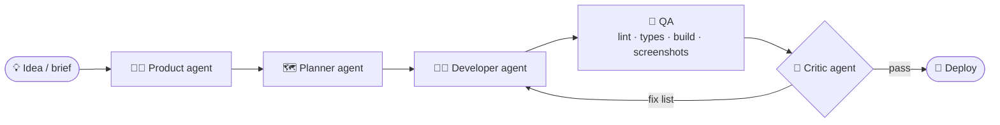

# Hi, I'm Ata 👋

  
  
  

---

### 🧭 About me

I'm a **Computer Engineer** (Yaşar University) with **5+ years** of professional experience. I've led front-end teams, set up project architectures and shipped products for **Pınar, Unilever, Beymen and KızlarSoruyor**, mostly with React, Next.js and TypeScript.

Over the past year I moved from **front-end to full-stack**. I now build with **Claude Code**, and not just as an assistant: I write my own **multi-agent pipelines**, custom skills and commands, and use them every day to take projects from idea to deployment. Front end, back end, hosting and all, with the quality bar I learned on large teams.

- 🛠️ &nbsp;Currently: delivering complete websites for clients, solo, end to end
- 🤖 &nbsp;Obsessed with: agent loops, custom skills, making AI output actually production-grade
- 🔐 &nbsp;Certified: ISO/IEC 27001 & 27701 (2026)
- 💬 &nbsp;Ask me about: React, Next.js, TypeScript, Claude Code workflows
- ⚡ &nbsp;Fun fact: *Bleach* the anime got its name from Nirvana's *Bleach* album

---

### 🤖 How I ship now

My own pipeline, running on Claude Code. Each role is a separate agent; they loop until the critic is happy.

---

### 🧰 Tech stack

  
   
  

  
  
  
  
  
  
  
  

---

### 💼 Experience

| Role | Company | When |
|---|---|---|
| **Full-Stack Developer** · freelance, AI-driven | Independent | 2025 → now |
| **Front-End Developer** | KızlarSoruyor | 2024 – 2026 |
| **Lead Front-End Developer** · led 2–3 devs | Appcent | 2021 – 2023 |
| **Full-Stack Intern** | Codespace | 2019 |

---

### 🏢 Selected work: brands & products

| Project | What I did | Stack |
|---|---|---|
| **[KızlarSoruyor](https://www.kizlarsoruyor.com)** | New features, rebuilt outdated sections, front end of the platform's first AI features | ASP.NET MVC · JS · Sass |
| **[KızlarSoruyor Ads](https://reklam.kizlarsoruyor.com)** | Interactive ad models for Koton, Amazon, Samsung, Pandora, Lenovo, Philips, Arçelik +7 more, plus the showcase site | TS · Next.js · Redux |
| **[PınarOnline](https://www.pinaronline.com)** | Led the front end for 1+ year, first page to launch, owned deployments | Next.js · Redux · AWS |
| **[Unishop](https://www.unishopturkiye.com)** | Unilever's store: home, profile and support pages | TS · Next.js · Redux |
| **Beymen Admin Panels** | Set up the architecture and led merchant + admin panels for 8 months | TS · React · RTK |
| **[Lightnift](https://lightnift.com)** | NFT analytics SPA with live collection data | Next.js · RTK · Sass |

### 🌐 Freelance: built end to end

| Project | | |
|---|---|---|
| **[Rightsoft](https://www.rightsoft.co.uk)** 🇬🇧 | Software company site, locomotive scroll & heavy motion | Next.js · Framer Motion |
| **[Sienna Art Studio](https://siennaartstudio.shop)** 🇺🇸 | Shopify theme redesign + admin panel for bulk uploads | Shopify |
| **[Vision Detail](https://visiondetail.com.tr)** | Product catalogue with a custom glass-style UI | — |
| **[NİP Mimarlık](https://nipmimarlik.com)** | Architecture studio site + brand guidelines | — |
| **[K2 Hukuk](https://k2hukuk.com)** | Law firm site, domain & company e-mail setup | — |
| **[Postacılar Yapı](https://postacilaryapi.com)** | Construction company, residential projects showcase | — |
| **[Ekin Nohutçu](https://ekinnohutcu.com)** | Portfolio for a game developer & PM | — |
| 🚧 **[Soft Tension Lab](https://soft-tension-lab-website.web.app)** | Editorial, animated studio site (in progress) | Next.js · SCSS |
| 🚧 **[Dentilion](https://dentilion-web-site.web.app)** | Dental clinic site with appointment requests (in progress) | — |

---

**Open to freelance projects and full-time roles.**
If you need a site built from idea to deployment, [let's talk](mailto:atabayraktar17@gmail.com).

<!--
  Optional: GitHub stats. Replace YOUR_USERNAME and paste above the closing section.

  

    
    
  

-->
